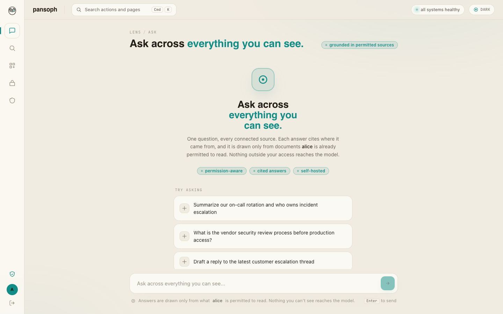
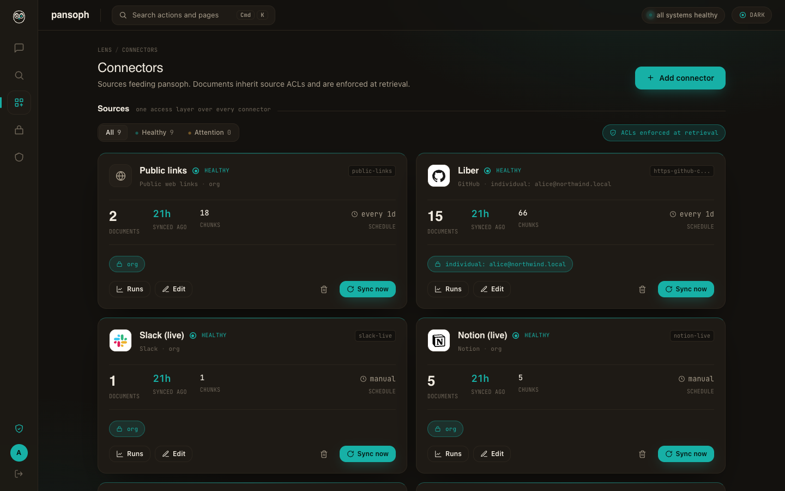

<div align="center">

<picture>
  <source media="(prefers-color-scheme: dark)" srcset="design/logo/owl-lockup-ondark.svg">
  
</picture>

<h3>Document level access control, enforced at retrieval, built in and fully removable.</h3>

<p>A self hostable, highly modular knowledge platform. Ingest an organization's knowledge from many disconnected sources into one access controlled retrieval, search, and chat layer, where a user can only ever retrieve what they are already allowed to see.</p>

[](https://github.com/autoargos/pansoph/actions/workflows/ci.yml)
[](LICENSE)
[](https://www.python.org/downloads/)
[](https://github.com/astral-sh/ruff)
[](CONTRIBUTING.md)
[](#status)

<p>
  <a href="#quick-start"><b>Quick start</b></a> &nbsp;·&nbsp;
  <a href="#status"><b>What works today</b></a> &nbsp;·&nbsp;
  <a href="docs/ARCHITECTURE.md"><b>Architecture</b></a> &nbsp;·&nbsp;
  <a href="CONTRIBUTING.md"><b>Contributing</b></a> &nbsp;·&nbsp;
  <a href="CHANGELOG.md"><b>Changelog</b></a>
</p>

<picture>
  <source media="(prefers-color-scheme: dark)" srcset="docs/assets/lens-ask-dark.png">
  
</picture>

</div>

## Why pansoph

Independent guidance is consistent that the feature which decides adoption of an internal knowledge tool is permission enforcement, not retrieval accuracy and not latency. The incumbents paywall exactly that. pansoph gives it away under Apache 2.0 and makes it a swappable plugin.

The single promise: a user can only ever retrieve what they are already allowed to see, across every connected source, and an operator can run the whole thing on their own hardware with their own models and replace any part of it. Self host first. No required cloud. No paywalled security. Bring your own model.

pansoph (from pansophy, universal knowledge, always lower case) is the platform that keeps that promise.

## Contents

- [Why pansoph](#why-pansoph)
- [The one principle: everything is replaceable](#the-one-principle-everything-is-replaceable)
- [Monorepo layout](#monorepo-layout)
- [The named services and apps](#the-named-services-and-apps)
- [The stack, in one line each](#the-stack-in-one-line-each)
- [Quick start](#quick-start)
- [Screenshots](#screenshots)
- [Status](#status)
- [Contributing and license](#contributing-and-license)

## The one principle: everything is replaceable

Every role is a port. Every default is one adapter behind that port. Nothing in the core depends on a concrete implementation. You can take only the pieces you want and replace or remove the rest, including the UI.

Ports in the first release: `Connector`, `Parser`, `Embedder`, `Reranker`, `LLM`, `VectorStore`, `Authz`, `Identity`, `IngestionWorkflow`, `ObjectStore`, `SecretStore`. The frontend is a replaceable consumer of the REST, MCP, and SSE contracts, not a dependency of the core.

## Monorepo layout

This is a uv workspace. Each package under `packages/` is independently versioned and publishable to PyPI, with a clean public API, and is usable standalone with no other pansoph package required.

```
pansoph/
  packages/
    pansoph-connector-sdk/   the connector contract + declarative manifest runtime
    pansoph-authz/           enforcement architecture + AuthzPort + SpiceDB/OpenFGA adapters + ACL->tuple mappers
    pansoph-retrieval/       hybrid retrieval + RRF + rerank + overfetch/bulk-check + VectorStore/Embedder/Reranker ports
    pansoph-ingestion/       parse/chunk/contextualize/embed + IngestionWorkflow + Parser/LLM ports
    pansoph-mcp-bridge/      MCP server -> connector bridge, and pansoph's own MCP server
    pansoph-core/            thin assembly: FastAPI app + REST + MCP + SSE surface
  apps/
    lens/                    "lens", the React 19 + Vite reference UI (will be split to its own repo)
    scout/                   "scout", the WXT MV3 browser grabber (will be split to its own repo)
  connectors/                community connectors (will be split to its own repo: pansoph-connectors)
  deploy/                    Dockerfiles, compose helpers, and ops (Helm chart planned, see deploy/README.md)
  docs/                      architecture, pointers to the ADRs
  compose.yaml               the self host stack, profiles: core, workers, models, observability, secrets
```

## The named services and apps

Deployable and user facing units carry a short, cohesive brand. The Python packages keep their functional names.

| Brand | What it is | Runs / lives in |
|---|---|---|
| **agora** | the backend: REST, MCP server, and SSE stream. The public square where you ask. | `pansoph-core`, image `cyproto/pansoph-agora` |
| **scribe** | the ingestion and permission sync workers. Gathers and transcribes every source. | `pansoph-ingestion`, image `cyproto/pansoph-scribe` |
| **lens** | the reference web UI. Verification first: see through every answer to its source. | `apps/lens`, image `cyproto/pansoph-lens` |
| **scout** | the browser grabber extension. Brings back only what you can already see, with consent. | `apps/scout` |
| **relay** | the MCP bridge. Any MCP server becomes a source. | `pansoph-mcp-bridge` |

## The stack, in one line each

- Backend: Python 3.12+ and FastAPI. Durable ingestion on DBOS (Postgres), Hatchet as the scale step up.
- Data: PostgreSQL 17 with pgvector, pgvectorscale, pgmq, pg_partman. Qdrant as the scale vector default.
- Authz: SpiceDB default, OpenFGA alternate, behind a minimal AuthzPort. Identity: built in store or Zitadel over OIDC.
- Models, BYOM: Ollama and vLLM local, any OpenAI compatible endpoint or OpenRouter cloud. Served embeddings and rerankers via HF TEI.
- Retrieval: Docling parsing, contextual retrieval, bge-m3 or Qwen3 embeddings, small cross encoder reranker, hybrid plus RRF, overfetch then bulk authz check.
- Infra: Valkey (not Redis), Garage or SeaweedFS (not MinIO), Postgres envelope encryption or OpenBao (not Vault).
- Frontend: React 19 and Vite, shadcn, assistant-ui plus Vercel AI Elements, Refine admin, SSE UI Message Stream.

See the decision records for the full rationale and the June 2026 sources:

- ADR-0001 the product vision: [`docs/adr/0001-modular-knowledge-platform/`](docs/adr/0001-modular-knowledge-platform/README.md)
- ADR-0002 the finalized tech stack: [`docs/adr/0002-finalized-tech-stack/`](docs/adr/0002-finalized-tech-stack/README.md)

## Quick start

```bash
# install the workspace toolchain
curl -LsSf https://astral.sh/uv/install.sh | sh
uv sync

# bring up the full local demo (Postgres, Valkey, Garage, SpiceDB, Ollama, TEI, API, workers, web)
docker compose --profile core --profile workers --profile models up
```

> Heads up: this profile brings up roughly a dozen services (Postgres, Valkey, an object
> store, SpiceDB, an identity provider, model servers, the API, and workers). It is a
> full self-hosted stack, not a five-minute taste. A single-command, single-connector
> demo behind a much smaller footprint is on the roadmap. Until then, see `DEMO.md` for
> the guided walkthrough.

For how access is decided and what you configure (identity, group aliases, and the current
limits), see [`docs/operating/identity-and-access.md`](docs/operating/identity-and-access.md).

## Screenshots

lens is the reference UI: verification first, so you can see through every answer to its source. It only ever shows what the signed in user is permitted to open. Light and dark themes are both first class.

<table>
  <tr>
    <td width="50%">
      
      <p align="center"><em>Connectors. Every source inherits its ACL, shown per instance.</em></p>
    </td>
    <td width="50%">
      
      <p align="center"><em>Ask, light theme. Answers are grounded only in permitted sources.</em></p>
    </td>
  </tr>
</table>

## Status

Pre-1.0 and under active development. This section tracks real, verified capability
honestly (see the "No fiction" rule in `CLAUDE.md`).

### What works today

The permission core is verified against real engines, not just fakes. CI gates every PR
with the permission red team (61 tests), connector conformance (128 tests, all 15
connectors), a live enforcement gate against a real SpiceDB and a real pgvector (9 tests),
a grabber safety guardrail (3 tests), and blocking mypy on the enforcement path. The full
hermetic suite is 342 tests.

- **Document-level access control, enforced at retrieval, verified live.** The path is
  embed, hybrid search with overfetch, a single `authz.bulk_check` at a freshness tied to
  the last permission write, keep only the allowed subset, apply deny as a final filter,
  then optionally rerank (`packages/pansoph-retrieval/src/pansoph_retrieval/pipeline.py`).
  The live gate stands up a real SpiceDB and pgvector and asserts a user never retrieves
  another user's restricted document, that tenants and instances are isolated, and that a
  revocation propagates with no stale read (`tests/integration/test_enforcement_live.py`).
- **Revocation and deletion propagate.** A re-scope or a source deletion deletes the
  reader tuples and purges the document from the vector store, proven live.
- **Fifteen connectors on one SDK contract**, each passing the hermetic conformance suite.
  The thirteen with a real permission model are audited against their current official
  docs and map source ACLs fail-closed (an unresolvable grant denies rather than leaks),
  adversarially reviewed for over-share.
- **Connect-then-pick onboarding.** Connect a source once (OAuth or a token), then pick
  what to sync from its real resources (your repos, drives, channels) instead of typing
  ids. The credential is sealed via the SecretStore, never stored in plaintext.
- **Identity materialization.** The query subject is the user's email (the cross-source
  principal) bound to the authenticated token, and an operator connects an IdP group to a
  connector's source group with a declared alias, so a fail-closed connector grant becomes
  reachable by exactly the mapped users. Covered by the permission red team (in-memory
  fakes) and the live SpiceDB plus pgvector enforcement gate.
- **agora REST, SSE, and discovery surface**: `/api/search`, `/api/chat` (SSE),
  `/api/grab`, `/api/health`, connector-instance management, resource discovery, and the
  group-alias admin routes (`packages/pansoph-core/src/pansoph_core/routes.py`).
- **Authz adapters** for SpiceDB (gRPC, bulk check, consistency token), OpenFGA (batch
  check), and a no-op adapter, behind a minimal `AuthzPort`. Vector adapters for pgvector
  (dense plus sparse plus RRF) and Qdrant.
- **Release supply chain**: SBOM (Syft), image scan (Grype, fail on fixable High or
  Critical), and keyless image signing (cosign) on release.

### What is in progress

We say this plainly so you can trust the line above:

- **Live connector coverage is partial.** GitHub, Notion, and the public-link fetcher are
  verified against real APIs (a real GitHub repo syncs and enforces RBAC end to end). The
  rest pass the hermetic conformance suite but still need credentials to be verified live.
- **Two source-API fidelity limits are documented, not fixed.** SharePoint classic Deny
  and broken inheritance, and Salesforce restriction rules, are not exposed by those APIs,
  so the connector cannot detect them. Both are flagged in-module and stay conservative.
- **Identity beyond email.** Direct grants and scopes resolve by email; source principals
  that are not emails (Slack user ids, GitHub logins, Confluence account ids) still need
  per-source linking beyond the email and group-alias model.
- **Durable ingestion.** A DBOS durable-execution wrapper exists as an optional dependency;
  the default local runner is a simple in-process scheduler.

Do not claim a feature works without an evidence trail. Every line above points at a test,
a run, or a file.

## Contributing and license

Contributions are welcome, especially new connectors and new port adapters, which plug in through Python entry points without touching the core.

- Start with [`CONTRIBUTING.md`](CONTRIBUTING.md) for the workflow and the local quality gates.
- Adding a connector or an adapter: read the connector implementation rule in [`CLAUDE.md`](CLAUDE.md), implement the contract or write a manifest, pass the shared conformance suite, and map the source ACL faithfully.
- Security reports: see [`SECURITY.md`](SECURITY.md). Please do not open a public issue for a vulnerability.
- Before a PR: `uv run ruff check . && uv run ruff format --check . && uv run pytest -q`, or install the hooks with `uv run pre-commit install`.

pansoph is licensed under the [Apache License 2.0](LICENSE).
