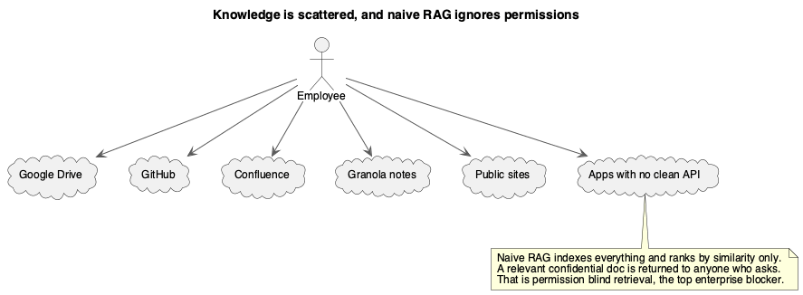
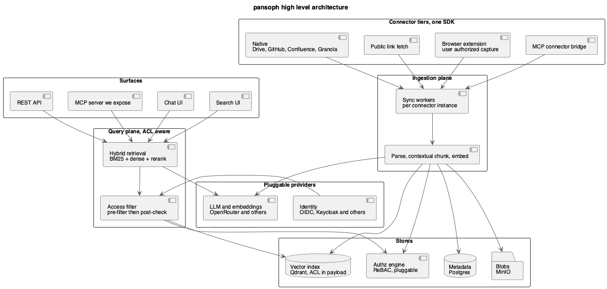
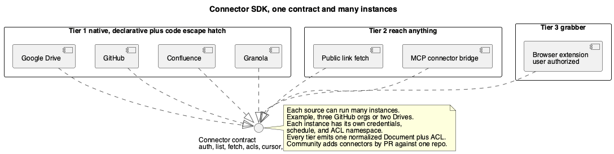
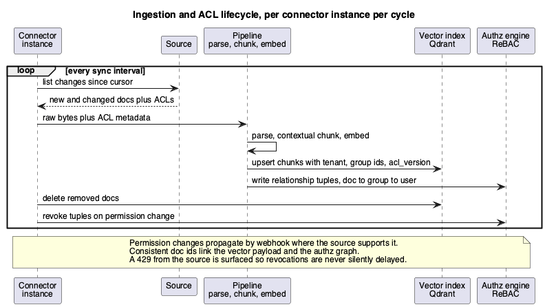
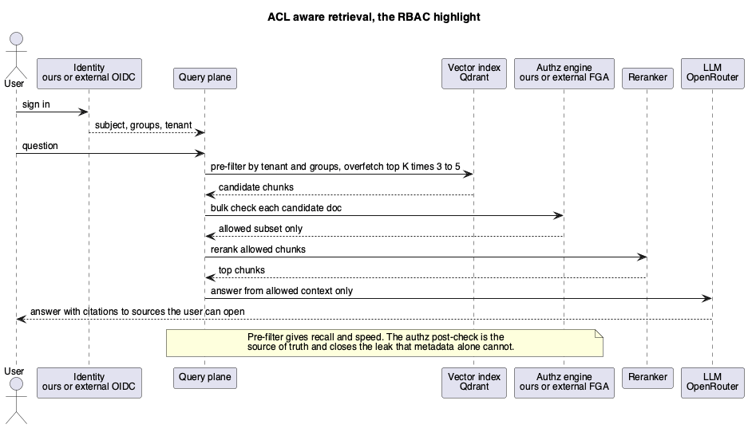
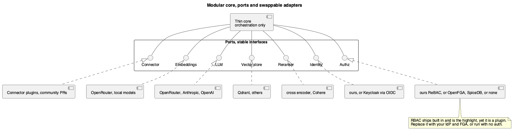
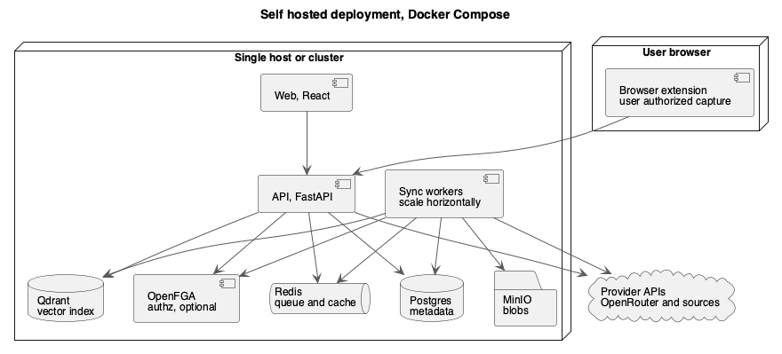

# ADR-0001: pansoph, an open source modular knowledge platform with ground-up RBAC

**Status:** Accepted
**Date:** 2026-06-07
**Author:** Yash Karande

Note on the name. The project is named pansoph, from pansophy, meaning universal knowledge. It is written in lower case everywhere.

> **Update 2026-06-08, see [ADR-0002](../adr-0002-finalized-tech-stack/).** The vision, the five bets, the connector tiers, the access control philosophy, and the Phase 1 scope below all still hold. The concrete technology choices were pressure tested with a June 2026 scan and finalized in ADR-0002. What changed from the text below: the backend stays Python and FastAPI (reaffirmed after a genuine reopening); the default authz engine is now SpiceDB with OpenFGA as a first class alternate, behind a minimal AuthzPort, where "ground up" means owning the enforcement architecture rather than reinventing Zanzibar; OpenRouter is no longer the default but one adapter behind bring your own model ports; Redis becomes Valkey; MinIO becomes Garage or SeaweedFS; Vault becomes OpenBao or Postgres envelope encryption; the queue becomes Postgres backed durable execution (DBOS then Hatchet); and the principle is hardened to total replaceability, where every role including the UI is a swappable port and every component is an independently publishable building block. The three open questions below are resolved in ADR-0002: default authz is SpiceDB, default embedding is bge-m3 at 1024 dimensions, and the license is Apache 2.0. Service and app brand names: agora (backend), scribe (ingestion workers), lens (web UI), scout (browser grabber), relay (MCP bridge).

## Context

Organizational knowledge lives in many disconnected places. Google Drive, GitHub, Confluence, Granola notes, public sites, and a long tail of apps that have no clean API. Finding things is slow, onboarding leans on tribal memory, and AI tools cannot reach company context safely.

There are many retrieval and chat products, yet the open source options force a hard tradeoff. The platforms that do permission aware retrieval well tend to paywall exactly that capability. The permissive ones treat access control as an afterthought you bolt on yourself. Independent guidance is consistent that the single feature that decides enterprise adoption is document level permission enforcement, not retrieval accuracy and not latency.

pansoph takes the opposite stance from the paywall pattern. It is a self hostable, highly modular knowledge platform that ingests an organization's knowledge into one access controlled retrieval, search, and chat layer. Document level access control is built from the ground up and is the headline feature, and it is also fully removable, so an operator can plug in their own identity and authorization stack instead.



## Decision

Build pansoph as an Apache 2.0 licensed, self hosted platform with a thin core and swappable plugins for every major role. Ship one connector SDK with three tiers, native connectors, a public link and MCP bridge, and a user authorized browser extension, with every source supporting many independent instances. Ship ground-up role and relationship based access control that an operator can replace with Keycloak, an external authorization service, or nothing at all. Run it as a Docker Compose stack that scales horizontally. Use Python with FastAPI on the backend and React on the frontend, and stay provider agnostic for models through OpenRouter.



## Why this is worth building

The current open source field, summarized from the market scan:

- **Onyx** has an MIT core, but RBAC, SSO, and permission sync live in a separately licensed enterprise directory, so the security feature is the upsell.
- **Open WebUI** ships RBAC and SCIM for free, but it is general purpose with thin connectors and is not search first.
- **RAGFlow** is Apache 2.0 and is adding connectors quickly, but document level ACL and permission sync are still shallow.
- **Dify** uses a modified license that forbids multi tenant resale and logo removal.
- **Connector infrastructure** such as Nango and Merge solves auth and sync well, but it is plumbing, not a knowledge platform.

The opening is a project that combines three things none of them combine: a permissive license, document level access control as a free first class feature, and a connector model that compounds through native connectors plus an MCP bridge plus responsible grabbers. RAGFlow is moving fast on connector count, so the durable advantage is the access control plus the breadth of reach, not raw connector numbers.

## The five bets

1. **One connector SDK, many instances.** Any source plugs in through the same contract. The community adds more by pull request against one connectors repository.
2. **Reach anything.** When no API exists, fall back through a public link fetcher, then an MCP bridge, then a user authorized browser extension. Never bypass authentication.
3. **Access control from the ground up, and removable.** Relationship based access control done well and enforced at retrieval, swappable for an external identity provider and authorization service, or switched off entirely.
4. **Modular by construction.** Embeddings, LLM, vector store, reranker, identity, and authz are all ports with adapters.
5. **Self host first.** A Compose stack, no required cloud, no paywalled security.

## Connector SDK

The connector layer is the part that compounds, so it is designed as a real SDK with one contract and three tiers. The design follows the lesson from Airbyte's low code connector framework. A strong declarative contract lets the runtime implement pagination, retries, backoff, incremental cursors, and resumable sync once, so every connector inherits them and bugs are fixed in one place. Connectors are declarative first, with a Python escape hatch for the awkward cases.



**Tiers.**

- **Tier 1, native.** First party connectors for Google Drive, GitHub, Confluence, and Granola. Granola has no bulk transcript API historically, so it is reached through its MCP server, which is also the first proof of the MCP bridge.
- **Tier 2, reach anything.** A public link fetcher for any directly fetchable URL, and an MCP connector bridge that turns any Model Context Protocol server into a connector. The MCP ecosystem passed ten thousand public servers and is governed under the Linux Foundation, so the bridge turns a very large catalog into instant connectors at near zero marginal cost.
- **Tier 3, grabber.** A browser extension that ingests what the signed in user can already see, with consent. This is the answer for sources that have neither an API nor an MCP server. It never replays credentials and never solves anti bot challenges.

**Multi instance.** Every source supports many independent instances, for example three GitHub orgs or two Drives. Each instance has its own credentials, sync schedule, and ACL namespace, and every document is tagged with its instance so isolation holds.

**Anything else we can include.** The same contract trivially covers Slack, Notion, Linear, S3 and object stores, and local files. Beyond that, the MCP bridge already reaches most other systems without writing a new connector, which is why it is a first class tier rather than a future idea.

**Connector contract.**

```
Connector
  capabilities: { incremental, permission_sync, deletions, slim_listing }
  auth:         oauth2 | api_token | service_account | none
  validate(config)            -> ok | error
  list_changes(cursor)        -> [DocRef], next_cursor     # incremental sync
  fetch(DocRef)               -> RawDoc + Acl
  list_acls(DocRef)           -> Acl                       # when permission_sync
  on_webhook(event)           -> [change]                  # optional, for freshness
```

A simple REST source is described by a manifest, and only unusual sources drop to code:

```
connector: confluence
auth: { type: oauth2, scopes: [read:confluence-content] }
capabilities: { incremental: true, permission_sync: true, deletions: true }
streams:
  - name: pages
    list: { path: /content, since: "$.results[*].version.when", cursor: lastModified }
    fetch: { path: /content/{id}?expand=body.storage,restrictions }
    acl:   { from: restrictions, groups: "$.read.group[*].name", users: "$.read.user[*].accountId" }
```

## Ingestion and ACL lifecycle

Ingestion is continuous and per instance. Each cycle lists changes since the last cursor, pulls new and changed documents together with their access control lists, parses and chunks them, embeds them, and upserts them into the vector index with the tenant and group identifiers and an ACL version. In parallel it writes relationship tuples into the authz engine. Deletions and permission changes propagate, by webhook where the source supports it. Rate limit responses from the source are surfaced rather than hidden, so a permission revocation is never silently delayed.



## Access control, the highlight

Access control is the headline, and it is built from the ground up rather than bolted on. It is also a plugin, so it can be replaced or removed.



**Two ports.**

- **Identity port.** The default is a built in store of users, groups, and organizations. It can be replaced by an external identity provider over OIDC, for example Keycloak, Auth0, or Okta. SAML and SCIM are later additions.
- **Authz port.** The default is a built in relationship based engine in the Google Zanzibar lineage, backed by Postgres, storing tuples such as user is a reader of document. It can be swapped for an external service such as OpenFGA, SpiceDB, or Cerbos, or set to none for an open single tenant deployment.

**Enforcement at retrieval, hybrid.** A coarse pre filter on tenant and group identifiers in the vector payload shrinks the candidate set and keeps recall high. The system overfetches the top candidates three to five times over, then runs a bulk authorization check against the authz engine and keeps only the allowed subset before reranking and answering. The pre filter gives speed and recall. The authz check is the source of truth and closes the leak that metadata alone cannot.

**Freshness.** ACLs carry a version field so caches invalidate instantly, permission change webhooks reconcile within minutes, and a consistent document id links the vector payload to the authz graph. Tenant isolation is hard at the index level.

**Ship without RBAC.** A single configuration choice runs pansoph open or single tenant. Operators who already run an identity and authorization stack point pansoph at theirs and remove the built in one. This removability is a first class requirement, not a side effect.

## Retrieval pipeline

The retrieval baseline is hybrid and modern. It combines BM25 and dense vectors with reciprocal rank fusion, and a cross encoder reranker selects the final chunks. Chunks are contextualized before embedding in the style of contextual retrieval, where a short generated summary is prepended to each chunk so it stands alone, which materially reduces retrieval failures. If a corpus is small, under roughly two hundred thousand tokens, the system can skip retrieval and pass the whole corpus to the model. Graph based indexers such as GraphRAG and RAPTOR are reserved behind a pluggable indexer interface rather than enabled by default, because their indexing cost is high and the gains are situational.

## Modularity

The core stays thin and only orchestrates. Every role is a port with a stable interface, and adapters are discovered as plugins through Python entry points, with namespaced groups per role. Integrations ship as separate packages, following the pattern proven by LangChain and LlamaIndex. The model and embedding default is OpenRouter so the system is provider agnostic from day one. Abstraction has a cost, so the contracts are kept minimal and the core avoids per call overhead.



Ports in the first release: Connector, Embeddings, LLM, Vector store, Reranker, Identity, Authz, and Parser.

## User experience

The interface follows verification first patterns from the best enterprise assistants. Answers carry inline citations, hovering a citation previews the source, and a citation deep links to the exact passage. Sources are permission aware, so a user can only open what they already have access to, and the assistant omits citations honestly when an answer comes from world knowledge rather than indexed sources. The frontend is built on React with assistant-ui and shadcn components, which give streaming, accessibility, and composable citation rendering. The primary screens are chat, search, connector administration, and access administration.

## Deployment

pansoph runs as a Docker Compose stack and scales horizontally. The services are the React web app, the FastAPI API, a pool of sync workers that scale out, Redis for the queue and cache, Postgres for metadata, Qdrant for the vector index, an optional OpenFGA for authz, and MinIO for blobs. The browser extension runs in the user's browser and posts captured content to the API. Outbound traffic goes only to provider APIs and to the configured sources.



## Data shapes

```
Document
  id            stable global id, "{connector}:{instance}:{source_doc_id}"
  connector     e.g. github
  instance_id   which configured instance produced this
  tenant_id     hard isolation boundary
  source_url    deep link back to the source
  title
  sections[]    ordered text blocks, each with optional heading and offsets
  mime, lang, content_hash
  created_at, updated_at
  acl           AccessControl
  acl_version   monotonic, used for cache invalidation
  extra         source specific metadata

AccessControl
  public           bool
  allow_groups[]   group principals
  allow_users[]    user principals
  deny[]           optional explicit denies, evaluated last
  principal_ns     the instance namespace these principals live in
```

## Phase 1 scope

Phase 1 is the full vertical, not a slice. It includes the Compose stack with all stores, the ingestion pipeline with per instance scheduling, the connectors for Google Drive, GitHub, Confluence, and Granola, the public link fetcher, the MCP bridge, and the browser extension, all multi instance. It includes the ground-up access control with the identity and authz ports, ACL aware hybrid retrieval, and permission sync where the source supports it. It includes the chat, search, REST API, and an MCP server that pansoph exposes, plus the connector and access administration screens. It uses OpenRouter for models and embeddings.

## Testing and security strategy

Permission tests are first class and gate releases. They include red team retrieval that asserts a user can never retrieve another user's restricted document, revocation latency tests, and tenant and instance isolation tests. Every connector passes one shared conformance suite that exercises the contract, incremental sync, deletions, and ACL mapping. Retrieval quality is tracked with an evaluation harness. The grabber tier has explicit guardrail tests that assert it never bypasses authentication, respects robots directives, and honors rate limits.

## What we explicitly do not ship

- No authentication bypass, no anti bot or CAPTCHA solving, and no credential replay scraping. The browser extension only captures what the signed in user can already see, with consent. This line is informed by current case law, which protects public data scraping but treats gated content and fake accounts as the red line.
- No hosted multi tenant SaaS in phase 1. pansoph is self host open source. A managed offering, if ever, is a separate decision.
- No SCIM or SAML in phase 1. OIDC is sufficient to start.
- No GraphRAG or RAPTOR enabled by default. The indexer port is reserved for them.
- No sub document field level redaction in phase 1. The document is the unit of access control.

## Open questions

- Whether the default authz is our own ReBAC engine or an embedded OpenFGA. The port makes this reversible, so the choice is about what to ship as the default.
- Default embedding model through OpenRouter, balancing quality, cost, and dimension.
- License is proposed as Apache 2.0, which gives a patent grant and a clean contrast to the paywalled enterprise directories of the incumbents.

## References

- Airbyte low code connector framework. https://docs.airbyte.com/platform/connector-development/config-based/low-code-cdk-overview
- Maintaining hundreds of connectors with the low code CDK. https://airbyte.com/blog/maintaining-hundreds-of-api-connectors-with-the-low-code-cdk-and-connector-builder
- Model Context Protocol overview. https://en.wikipedia.org/wiki/Model_Context_Protocol
- Claude desktop extensions and MCP bundles. https://www.anthropic.com/engineering/desktop-extensions
- Document level RBAC for RAG pipelines. https://truto.one/blog/how-to-maintain-document-level-rbac-in-enterprise-rag-pipelines/
- OpenFGA, Zanzibar style fine grained authorization. https://openfga.dev/
- ReBAC for RAG at scale. https://www.descope.com/blog/post/rebac-rag
- Anthropic contextual retrieval. https://www.anthropic.com/news/contextual-retrieval
- hiQ, Van Buren, and Meta v Bright Data scraping case law. https://www.fbm.com/publications/what-recent-rulings-in-hiq-v-linkedin-and-other-cases-say-about-the-legality-of-data-scraping/
- Glean citations and verification UI. https://docs.glean.com/user-guide/assistant/glean-chat/glean-chat-citations/glean-citations
- assistant-ui React chat library. https://www.assistant-ui.com/
